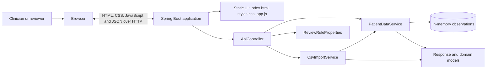
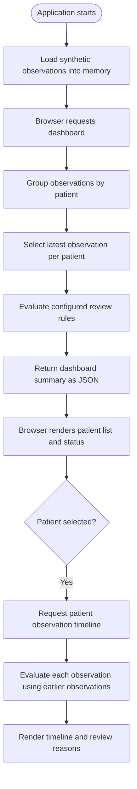
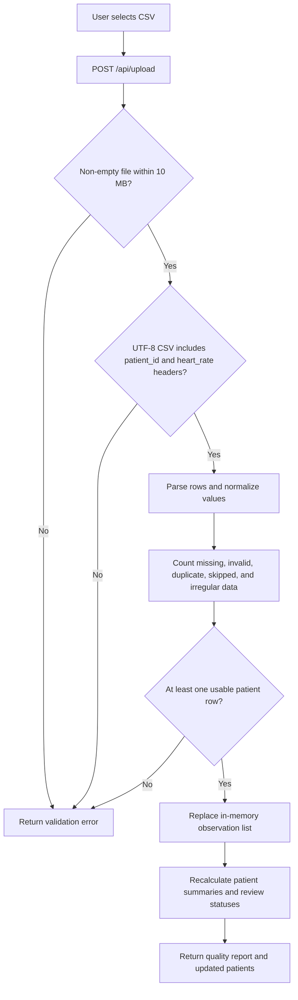
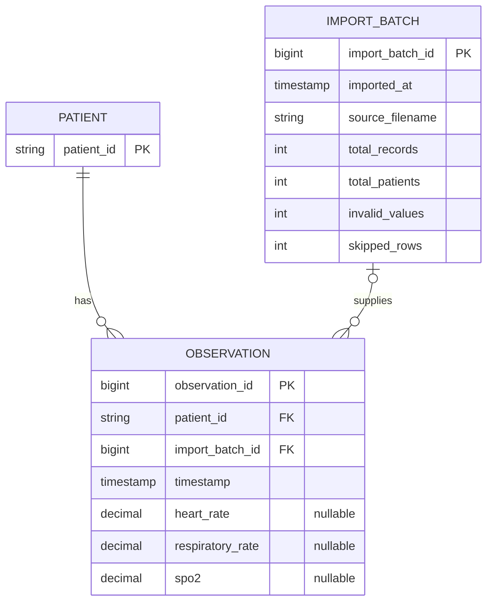

# PulsePredict ICU Review Dashboard: Project Design

## Scope

The documented dashboard is the Spring Boot application. It serves the web UI and JSON API from one server. The repository also contains a separate Vite/React prototype; that prototype is not the dashboard described below.

This is a demonstration for review of synthetic or appropriately de-identified observations. It is not clinically validated and must not be used to make patient-care decisions.

## System Architecture

The browser UI is served from `src/main/resources/static`. The same Spring Boot process handles `/api` requests. There is no separate API server, database server, authentication module, or message queue in the current implementation.

## Modules and Components

| Component | Responsibility | Contribution to the project |
| --- | --- | --- |
| Static web UI | Renders the dashboard, patient timelines, rule information, and CSV upload form; calls the JSON API. | Gives reviewers a way to inspect patient summaries, see trends and review reasons, and import a CSV without calling the API directly. |
| `ApiController` | Exposes dashboard, observation timeline, review-rule, and CSV-upload endpoints. | Acts as the HTTP entry point. It connects browser actions to services and returns structured JSON while keeping request handling separate from business logic. |
| `PatientDataService` | Creates startup demo data, groups observations by patient, produces summaries, and evaluates review rules. | Provides the dashboard's core behavior: patient list, latest readings, timelines, counts, and explainable `ROUTINE` or `REVIEW` results. |
| `CsvImportService` | Parses and validates CSV input, normalizes timestamps and numeric values, calculates import-quality counts, then replaces the active observations. | Lets a reviewer use an external dataset while surfacing data-quality issues instead of silently treating malformed values as valid measurements. |
| `ReviewRuleProperties` | Holds configurable thresholds for heart rate, respiratory rate, SpO2, and the heart-rate trend window. | Keeps demonstration thresholds in configuration, so review behavior can be adjusted without changing the service's evaluation code. |
| Model records | Represent observations, patient/dashboard summaries, review results, and CSV import-quality results. | Define consistent data shapes between services and API responses, making dashboard values and review explanations predictable for the UI. |
| In-memory observation list | Temporary runtime storage. Uploaded data is lost when the application restarts. | Keeps this prototype simple to run without database setup, while limiting it to temporary, single-process demonstration data. |

The architecture diagram shows the main contribution paths: the browser uses the UI and API, the controller delegates work to services, and the patient service reads the active in-memory observations. The importer feeds validated observations into that same data source. Keeping these responsibilities separate makes it easier to replace the temporary storage later without redesigning the browser workflow.

### API Surface

| Method and route | Purpose |
| --- | --- |
| `GET /api/patients` | Return patient count, review count, newest observation time, and each patient's latest summary. |
| `GET /api/patients/{patientId}/observations` | Return a patient's chronological observations with computed review results. |
| `GET /api/rules` | Return active thresholds, trend window, and whether a CSV has been uploaded. |
| `POST /api/upload` | Accept a multipart CSV field named `file`; return import-quality information and updated patient summaries. |

Together, these endpoints give the browser focused capabilities: overview data, patient history, active review settings, and dataset import. This keeps the UI from needing to implement data processing or review rules itself.

## Workflows

### Application and Dashboard

This workflow shows how the architecture contributes to the reviewer experience. Startup data makes the dashboard immediately demonstrable; the service creates summaries and review explanations; selecting a patient loads their chronological history for further inspection.

### CSV Import

This workflow lets reviewers inspect their own eligible CSV while protecting the active dataset from unusable uploads. Validation and quality counts expose issues, and an accepted import updates the same patient summaries and timelines used by the dashboard.

### Review Evaluation

Each observation is evaluated against the current configured rules. The default demonstration thresholds are heart rate above 120 bpm or below 45 bpm, respiratory rate above 24/min, SpO2 below 92%, or a heart-rate change of at least 25 bpm within six hours. A trend comparison uses the nearest strictly earlier observation with a heart-rate value in the configured time window; future observations are not used. Missing measurements are not imputed. Results are `REVIEW` when one or more reasons apply and `ROUTINE` otherwise.

This contributes transparent, rule-based context rather than a black-box prediction: each review status can be accompanied by the specific threshold reason that triggered it. These are demonstration rules and are not clinically validated.

## Dataset Design

### Startup Dataset

At startup, `PatientDataService` creates synthetic data for six patient IDs with 15 observations each (90 observations total). The first observation for each patient is anchored about 34 hours before startup, with later observations spaced roughly 105-145 minutes apart. Some measurements are intentionally missing, and some values exercise the demonstration review rules. The dataset exists only in memory.

The synthetic dataset makes the UI and review workflow usable without an external data source. Its patient identifiers group the observations, timestamps support chronological timelines and trend checks, and intentional missing values let the import and display paths represent incomplete real-world measurements without imputing them.

### CSV Input

The upload must be a UTF-8 CSV with a header row. The upload limit is 10 MB.

| Column | Requirement | Type and handling |
| --- | --- | --- |
| `patient_id` | Required column and required for a usable row | Text identifier; whitespace is trimmed. Rows with a blank ID are skipped. |
| `heart_rate` | Required column | Numeric bpm in the accepted range 1-300. Missing values remain null; malformed or out-of-range values are counted as invalid and treated as null. |
| `timestamp` | Optional | Accepts ISO instant, offset date-time, local date-time, or date. Missing or invalid timestamps receive generated fallback timestamps and are reported in import quality. |
| `respiratory_rate` | Optional | Numeric breaths/min in the accepted range 1-100. Missing or invalid values remain null. |
| `spo2` | Optional | Numeric percent in the accepted range 0-100. Missing or invalid values remain null. |

Rows are sorted by patient ID and timestamp after parsing. Duplicate patient/timestamp pairs are counted but retained. An upload replaces the current dataset rather than appending to it; restarting restores synthetic demo data. The import report includes record and patient totals, missing measurement/timestamp counts, defaulted timestamps, invalid values, duplicate timestamps, irregular sampling, and skipped rows.

## Database Design

### Current Storage

There is **no database in the current project**. `PatientDataService` stores observations in a thread-safe in-memory list. Patient summaries and review results are calculated when requested; neither is persisted. Uploaded CSV data replaces the active list and disappears on restart. The current Maven dependencies include no database driver or ORM.

### Proposed Relational Design for Persistence

If the application later needs persistent data, the following is a logical schema proposal, not an implemented schema:

Review status and reasons should be a computed result or database view rather than authoritative stored data, because changing the configured rules can change a result for an existing observation. They are not stored in the current implementation.

The proposed entities each serve a distinct purpose: `PATIENT` identifies the subject, `OBSERVATION` stores timestamped measurements, and `IMPORT_BATCH` optionally tracks the source upload and its quality summary. This structure would support persistence and patient-history queries while keeping review status derived from the measurements and current rules. It is a future design only; the running project currently uses in-memory data.

Recommended relational constraints and indexes:

- `PATIENT.patient_id` is the primary key; `OBSERVATION.patient_id` references it.
- `OBSERVATION.observation_id` is a generated primary key. Do not make `(patient_id, timestamp)` unique if the database must preserve the current behavior of retaining and reporting duplicate timestamps.
- Index `OBSERVATION(patient_id, timestamp)` for patient timeline queries and chronological processing.
- Keep vital measurements nullable so missing values remain missing rather than being imputed.
- `IMPORT_BATCH` is optional provenance for a persistent implementation. It does not exist in the current runtime model.